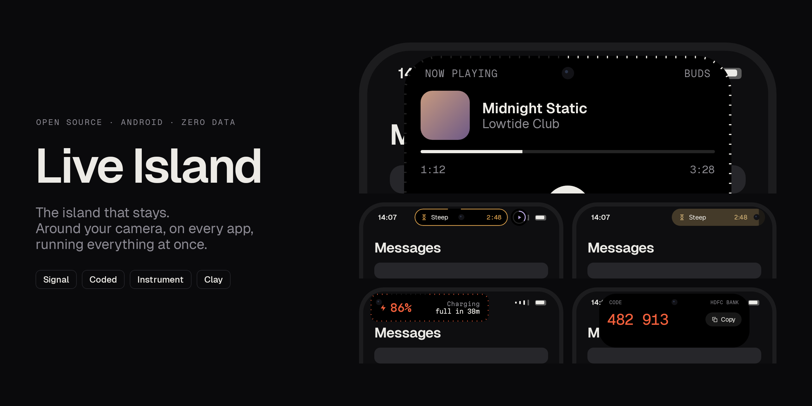
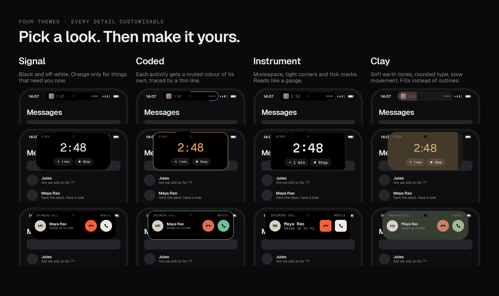
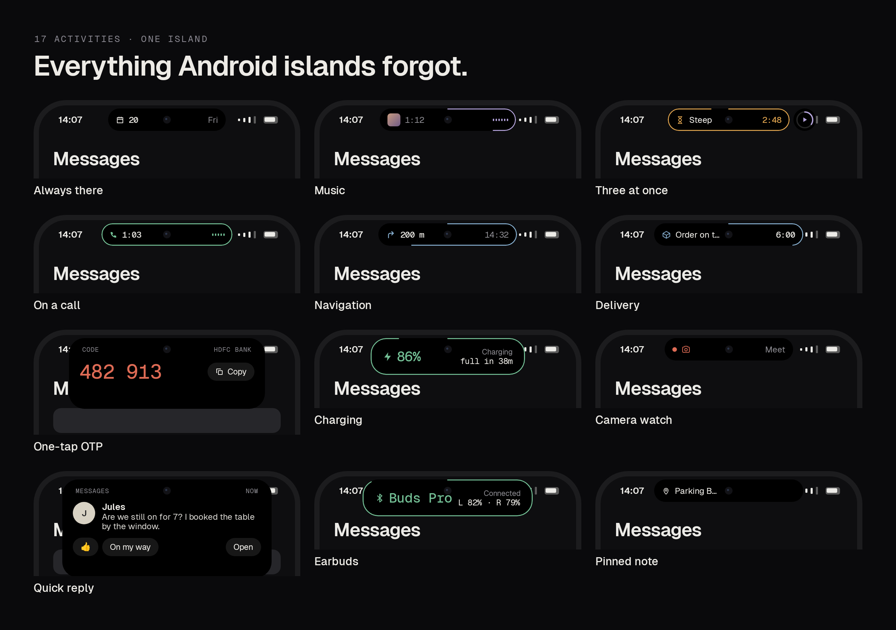
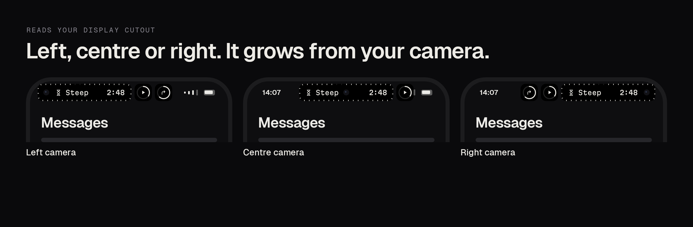
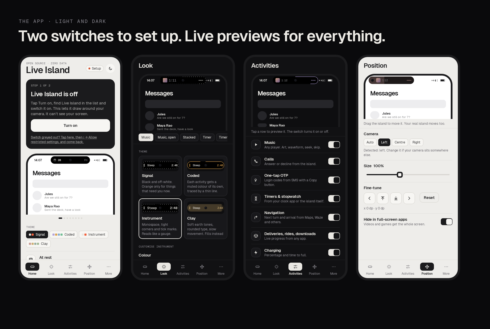

<div align="center">



# Live Island

**The Android island that stays.** Around your camera, on every app, running everything at once.<br>
Open source. Zero data. No internet permission at all.

<br>

<a href="https://github.com/divitcr7/live-island/releases/latest/download/LiveIsland.apk">
  
</a>
&nbsp;


<br><br>

<a href="https://github.com/divitcr7/live-island/releases"></a>
<a href="https://github.com/divitcr7/live-island/releases/latest"></a>
<a href="https://github.com/divitcr7/live-island/releases/latest"></a>
<a href="https://github.com/divitcr7/live-island/stargazers"></a>
<a href="https://github.com/divitcr7/live-island/actions/workflows/ci.yml"></a>


</div>

---

## Why another island?

Every Android island so far copies a pill that pops up, says one thing and disappears. Live Island does what they don't:

| Other islands | Live Island |
|---|---|
| Hide when nothing's happening | **Always there.** Shows your next event, battery, a countdown or a note, or shrinks to a ring around the lens |
| One thing at a time | **Several at once.** Music, a timer and directions run together as satellites |
| Mirror notifications | **Do things.** Answer calls, copy OTPs, reply, skip songs, start timers |
| Look like iOS, Material or One UI | **Its own design.** Four themes, every detail adjustable |
| Assume a centred camera | **Fit your phone.** Reads the cutout; left, centre or right; drag to place, resize |
| Analytics, ads, accounts | **Nothing.** The app can't even reach the internet |

## Four themes. Then make it yours.



**Signal** is black and off-white, with orange only for what needs you now. **Coded** gives each activity its own muted colour. **Instrument** is all monospace, with tight corners and tick marks like a gauge. **Clay** uses earth tones, rounded type and slow motion.

For any theme you can change the colour, how progress shows on the edge (line, ticks, underline, fill), the corners, the body, the typeface and the motion.

## Everything Android islands forgot



<table>
<tr><td>

**Every day**
- 🎵 Music from any player: art, waveform, seek, skip
- 📞 Answer or decline calls, then a call timer
- 🔑 **One-tap OTP**: SMS codes with a Copy button
- ⏳ Timers and stopwatch, several at once
- 🧭 Turn-by-turn from Maps, Waze, OsmAnd, Organic Maps
- 📦 Deliveries, rides and downloads (Android 16 Live Updates too)
- 💬 Message peeks with quick reply

</td><td>

**Things nobody else does**
- 🛰️ Satellites: several activities at once
- ⚡ Real charging watts and battery temperature
- 📷 Which app is using your camera or mic, by name
- 🎧 Earbud and watch battery when they connect
- 📌 Pin a note: door code, parking spot
- 🗓️ Countdowns: "Goa trip in 3d"
- 🎯 Focus sessions that silence everything but calls
- ⌨️ Command bar: hold and type `timer 10`, `torch`, an app
- 📥 Shelf: drop files and links on the island, drag them out later
- 🤖 Tasker and script automation

</td></tr>
</table>

## Fits your camera



## The app



Two switches to set up. A live preview on every screen, so you see the result before you leave the page. Light, dark, or follow your phone.

---

## Install

> **Google Play: free, coming soon.** Until then, install from GitHub in about a minute.

1. **[Download LiveIsland.apk](https://github.com/divitcr7/live-island/releases/latest/download/LiveIsland.apk)** on your phone.
2. Open it from your Downloads and tap **Install**.
   <details>
   <summary><b>"App blocked to protect your device"?</b></summary>

   Play Protect blocks *any* app installed outside the Play Store that asks for Accessibility or Notification access. Every island app needs both, so this isn't specific to Live Island. To install:

   1. Play Store → your profile picture → **Play Protect** → ⚙ → turn off **Scan apps with Play Protect**.
   2. Samsung only: **Settings → Security and privacy → Auto Blocker** → off.
   3. Install the APK, then turn both back on. Live Island stays installed.
   </details>
3. Open **Live Island** and tap **Turn on** for both switches.
   <details>
   <summary><b>Accessibility switch greyed out?</b></summary>

   Android 13+ restricts sideloaded apps. Tap the link in the app (or **Settings → Apps → Live Island → ⋮ → Allow restricted settings**), then try again.
   </details>
4. Samsung, Xiaomi, OnePlus: set **Battery → Unrestricted** for Live Island so the system doesn't put it to sleep.

Check your download: every release includes `LiveIsland.apk.sha256`.

## Using it

| Gesture | Does |
|---|---|
| **Tap** | Open / close |
| **Swipe ← →** | Switch between running activities |
| **Swipe ↓** | Open the full card |
| **Swipe ↑** | Shrink one step (it never fully hides); on a pop-up, dismiss it |
| **Hold** | Command bar: `timer 10`, `focus 25`, `note door 4471`, `torch`, `wifi`, app names |
| **Double-tap** | Main action: play/pause, answer, copy |
| **Share → Live Island** | Put anything on the shelf |

## Battery

Built to cost nothing when nothing is happening:

- **Fully asleep with the screen off.** No timers, no polling, no drawing.
- **Event-driven.** Music, calls, notifications, charging, camera/mic and Bluetooth arrive from Android; nothing is polled.
- **Ticks only as often as needed.** Every second only while a timer, call or song is showing; every few seconds to rotate resting facts; otherwise once a minute.
- **Cheap animation.** The waveform steps at about 8 fps and stops when music pauses. The window is resized once per transition, not every frame.
- **No disk churn.** Settings change in memory and are saved once you stop dragging or sliding.

## Privacy

- **No internet permission.** Android won't let the app send anything, anywhere. The Privacy screen checks this live.
- No account, analytics, ads or crash reporting.
- Notifications are read in memory and forgotten when they disappear.
- Accessibility is used only to draw over the status bar and to know which app is open (so it can hide where you choose). `canRetrieveWindowContent` is **false**: it cannot read your screen.

| Permission | Used for |
|---|---|
| Accessibility | Drawing over the status bar; hiding in apps you choose |
| Notification access | Music, calls, timers, navigation, live updates, codes |
| Calendar *(optional)* | Next event at rest |
| Phone calls *(optional)* | Answer / decline |
| Nearby devices *(optional)* | Earbud and watch battery |
| Do Not Disturb *(optional)* | Focus sessions |

---

## Automation

Turn on **More → Automation**, then from Tasker, MacroDroid, Automate or a shell:

```bash
am broadcast -a app.liveisland.SHOW --es id build --es title "Build #42" --es text "Running tests" --ei progress 60 --ei seconds 120
am broadcast -a app.liveisland.DISMISS --es id build
```

| Extra | Meaning |
|---|---|
| `id` | Item to create or update |
| `title`, `text` | Main and second line |
| `source` | Small label, e.g. `Home Assistant` |
| `progress` | 0–100, drawn on the edge |
| `countdown` | Seconds to count down |
| `seconds` | Remove after this long |

## Build from source

Kotlin + Jetpack Compose with no Material library. JDK 17, Android SDK 35.

```bash
./gradlew :app:assembleDebug          # app/build/outputs/apk/debug/app-debug.apk
./gradlew :app:testDebugUnitTest      # unit tests + screen renders
./gradlew :app:recordPaparazziDebug   # re-render every screen and island state
```

```
app/src/main/java/app/liveisland/
├── core/      settings, storage, models
├── engine/    what's on the island, priorities, timers, commands, OTP detection
├── island/    the renderer, shared by the overlay and every preview
├── sources/   media, notifications, battery, camera/mic, Bluetooth, calendar, automation
├── service/   accessibility overlay, notification listener, cutout detection
├── shelf/     shelf storage and share target
└── ui/        the settings app ("Paper" design language)
```

The island that runs on your phone and the previews in the app are the same code, so what you pick is exactly what you get. The README images are rendered from it too (`app/src/test/java/app/liveisland/readme`).

### Releasing

Push a tag and GitHub Actions builds, signs and publishes `LiveIsland.apk`:

```bash
git tag v0.1.0 && git push origin v0.1.0
```

Signing uses four repository secrets: `LI_KEYSTORE_BASE64`, `LI_KEYSTORE_PASSWORD`, `LI_KEY_ALIAS`, `LI_KEY_PASSWORD`.

## Roadmap

- [x] Always-on island, four themes, full customisation
- [x] Calls, music, OTP, timers, navigation, live updates, satellites, shelf, command bar
- [ ] Google Play release (free)
- [ ] F-Droid / IzzyOnDroid
- [ ] Lyrics, per-app colours, more automation hooks

## Credits

Fonts: [Geist & Geist Mono](https://vercel.com/font) (Vercel), [Figtree](https://github.com/erikdkennedy/figtree), [Martian Mono](https://github.com/evilmartians/mono), all SIL Open Font License (see `licenses/`).

<div align="center"><br><sub>Made by <a href="https://github.com/divitcr7">divitcr7</a> · If Live Island is on your phone, a ⭐ helps others find it.</sub></div>
